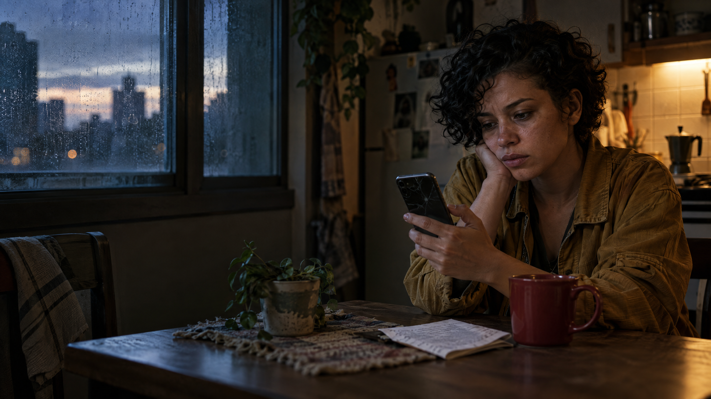

# Natural ou Fake Natty? — A Última Mensagem

> **Um experimento de realismo generativo:** se uma história parece íntima, imperfeita e humana, ainda importa saber quem a criou?



## Veredito

# **Fake Natty**

Este projeto foi criado com Inteligências Artificiais Generativas. O objetivo não é esconder isso, mas testar até onde uma narrativa sintética pode reproduzir os sinais que normalmente associamos à autenticidade: uma lembrança específica, uma pausa estranha, um objeto comum sobre a mesa e uma mensagem que parece ter sido escrita por alguém de verdade.

---

## 1. A ideia

**A Última Mensagem** é uma microficção multimídia sobre Lia, uma fotógrafa que encontra no celular uma mensagem programada para chegar depois que sua antiga casa já foi esvaziada.

A história foi desenhada para parecer um fragmento documental: não há grandes reviravoltas, apenas detalhes cotidianos e uma pergunta sem resposta. A escolha foi intencional. Conteúdos generativos costumam tentar impressionar; este experimento tenta **parecer lembrança**.

### O desafio criativo

Criar uma peça que pudesse ser confundida com um registro humano espontâneo sem afirmar, em nenhum momento, que a personagem ou o acontecimento são reais.

---

## 2. O conteúdo

### Microficção

> **A última mensagem**
>
> Lia só percebeu que a casa estava silenciosa quando o celular vibrou.
>
> Não era uma notificação. Era uma mensagem agendada, enviada do próprio número, com data de seis meses antes:
>
> _“Quando você encontrar isto, não volte para buscar a caixa azul. Eu já coloquei tudo que importava dentro dela.”_
>
> A caixa azul estava em cima da geladeira. Dentro, havia três fotografias, uma chave que não abria mais porta nenhuma e o recibo de um café tomado numa terça-feira de chuva.
>
> No verso da última fotografia, alguém tinha escrito: _“Você sempre vai achar que chegou tarde.”_
>
> Lia leu duas vezes. Depois abriu a janela, deixou a chuva entrar e respondeu para o próprio número:
>
> _“Desta vez, eu cheguei.”_

### Capa visual

A capa mostra Lia numa cozinha ao amanhecer, diante de um celular antigo e de uma carta dobrada. A composição privilegia pequenas imperfeições: luz mista, textura de pele, objetos deslocados e um enquadramento que parece observado, não posado.

---

## 3. Como foi produzido

| Etapa | Ferramenta / técnica | Decisão criativa |
|---|---|---|
| Conceito | Escrita assistida por IA + curadoria humana | Escolher uma situação íntima, curta e ambígua |
| Texto | Modelo de linguagem | Pedir contenção, detalhes sensoriais e subtexto |
| Imagem | IA generativa de imagens | Usar fotografia documental, sem texto na imagem |
| Curadoria | Edição humana | Remover exageros, clichês e frases que soassem “perfeitas demais” |
| Transparência | README + prompts versionados | Registrar a origem sintética do material |

### Regra de autenticidade

A intenção foi **parecer natural, não fingir ser factual**. A personagem é fictícia; a imagem é sintética; a experiência narrada não aconteceu. A estética de realidade é parte do experimento, não uma alegação de realidade.

---

## 4. Prompts utilizados

Os prompts completos estão em [`prompts/`](prompts/):

- [`01-conceito-e-voz.md`](prompts/01-conceito-e-voz.md) — direção narrativa;
- [`02-microficcao.md`](prompts/02-microficcao.md) — geração do texto;
- [`03-capa-visual.md`](prompts/03-capa-visual.md) — direção da imagem.

Os prompts estão em inglês quando destinados ao gerador visual, pois isso melhora a consistência de composição e fotografia. O conteúdo final permanece em português.

---

## 5. O que torna o conteúdo “quase real”?

- **Detalhes específicos:** recibo, chave sem porta, caixa azul, janela aberta;
- **Imperfeição controlada:** a personagem não explica tudo e a mensagem não fecha a história;
- **Escala cotidiana:** nada depende de um evento extraordinário;
- **Silêncio:** a ausência de informação cria mais verossimilhança do que uma explicação completa;
- **Consistência entre mídias:** texto e imagem apontam para o mesmo universo emocional;
- **Transparência:** a obra declara sua natureza artificial em vez de explorar a dúvida para enganar.

---

## 6. Limitações e ética

Este projeto não usa a imagem, a voz ou a história de uma pessoa real. Não há tentativa de imitar uma personalidade pública, fabricar prova de um acontecimento ou induzir uma pessoa a acreditar que a narrativa é factual.

A pergunta do desafio continua aberta: **se o conteúdo parece humano, o que exatamente estamos reconhecendo como “humano” — a origem, a intenção ou a sensação causada em quem lê?**

---

## 7. Estrutura do repositório

```text
natty-or-not/
├── README.md
├── .gitignore
├── assets/
│   └── capa-a-ultima-mensagem.png
├── docs/
│   ├── historia.md
│   └── ficha-tecnica.md
└── prompts/
    ├── 01-conceito-e-voz.md
    ├── 02-microficcao.md
    └── 03-capa-visual.md
```

---

## 8. Como reproduzir

1. Faça um fork deste repositório.
2. Leia os prompts em `prompts/`.
3. Gere uma nova versão do texto e/ou da imagem usando uma ferramenta de sua escolha.
4. Compare o resultado com a versão curada neste projeto.
5. Registre no README quais partes foram geradas e quais foram editadas por você.

---

## 9. Compartilhe

Se este experimento provocar alguma dúvida — ou uma lembrança — compartilhe seu próprio veredito:

**Natural ou Fake Natty?**

`#LabDIONattyOrNot`

Projeto desenvolvido para o desafio da **DIO**, com menção a **@falvojr** conforme a proposta original.

---

## Licença

Conteúdo autoral ficcional produzido para fins educacionais e de portfólio. Você pode adaptar a estrutura e os prompts, mantendo os créditos do desafio e informando o uso de IA generativa.
